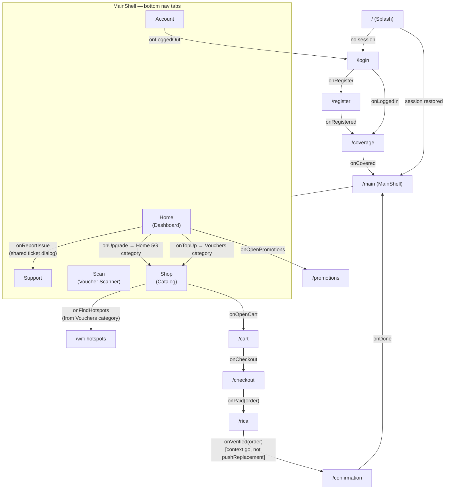
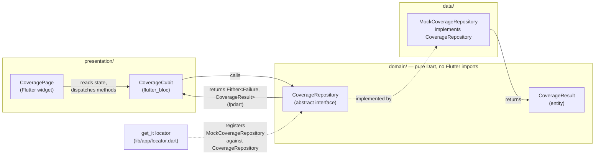
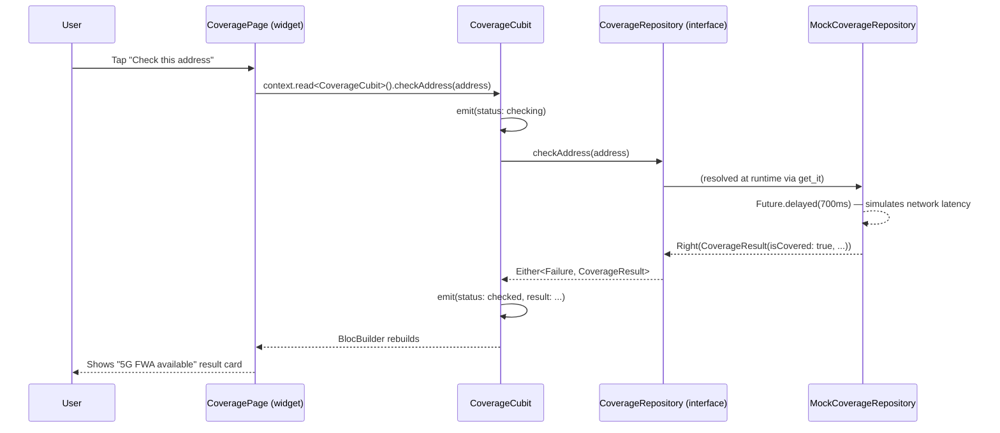
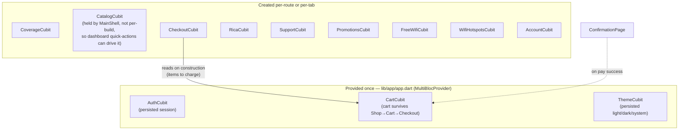

# Sentech Connect — Architecture

Companion to [`../README.md`](../README.md). Three diagrams: the screen-to-screen navigation graph, the Clean Architecture layering used inside every feature, and the request path for a single screen from tap to (mock) data source.

## 1. Navigation graph

Every route in `lib/app/router/app_router.dart`, and what triggers each transition. `MainShell` is drawn as one node with its five tabs expanded underneath it — those tab switches are local widget state (`IndexedStack`), not `go_router` navigation.

**Why RICA → Confirmation uses `context.go()` and not `context.pushReplacement()`:** the latter triggered an intermittent Flutter Hero-controller assertion (`manifest.fromHero == newManifest.toHero`) when combined with the always-mounted `MainShell` `IndexedStack` underneath. See the README's "Known gotchas".

## 2. Clean Architecture layering (per feature)

Every feature folder under `lib/features/` follows this shape. `coverage` is used here as the concrete example; every other feature (`catalog_checkout`, `rica`, `wifi_voucher`, `promotions`, `support`, …) is structured identically.

**The seam that matters:** `Cubit` only ever imports `domain/repositories/coverage_repository.dart` (the interface), never the `Mock` class directly. A real `HttpCoverageRepository` slots in by changing one registration line in `lib/app/locator.dart` — see the README's "Swapping a mock for a real backend".

## 3. Request path — tap to (mock) data, using "Check this address"

A concrete sequence for one interaction, showing every layer a single user action passes through.

Every other Cubit in the app (`CatalogCubit`, `CheckoutCubit`, `FreeWifiCubit`, `SupportCubit`, …) follows this exact same shape: emit a loading state, call the repository interface, `.match()` the `Either<Failure, T>` result (via `fpdart`), emit the new state.

## App-root state vs. per-screen state

Two different lifetimes exist in this app, worth keeping straight when adding a new feature:

`CatalogCubit` is the one exception to "created per-route": it's held as a field on `_MainShellState` (not created inline in the tab list) specifically so the dashboard's "Top up"/"Upgrade" quick actions can call `.selectCategory()` on the *same* instance the Shop tab is displaying, rather than only being able to switch tabs blindly.
